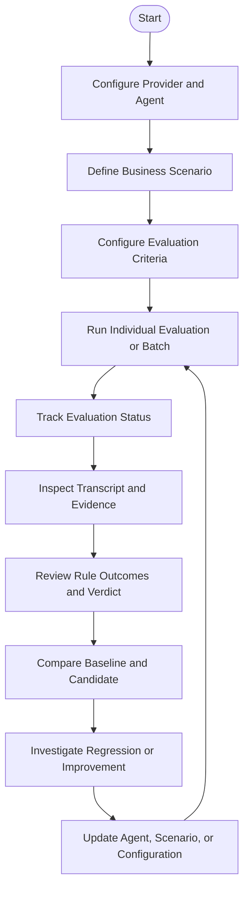
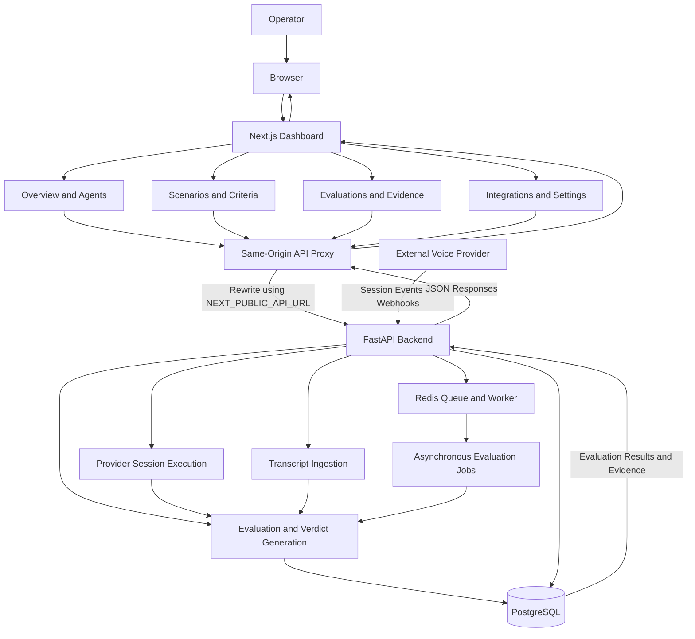
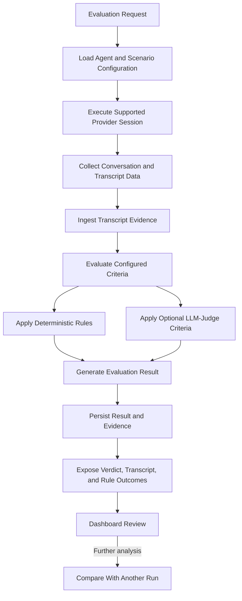
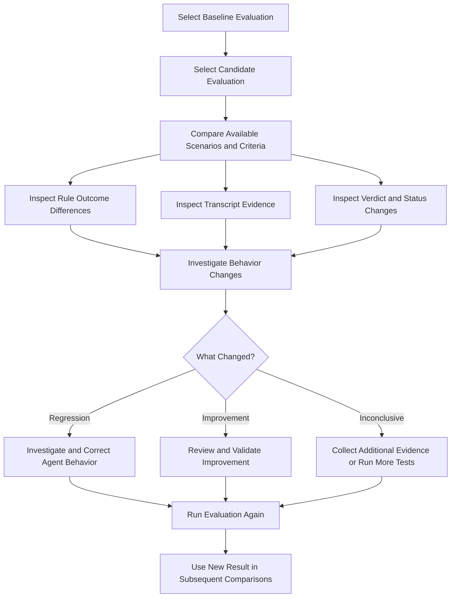
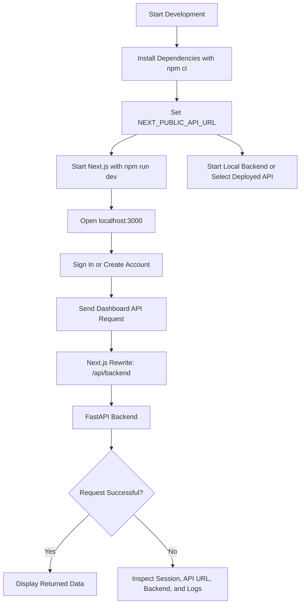
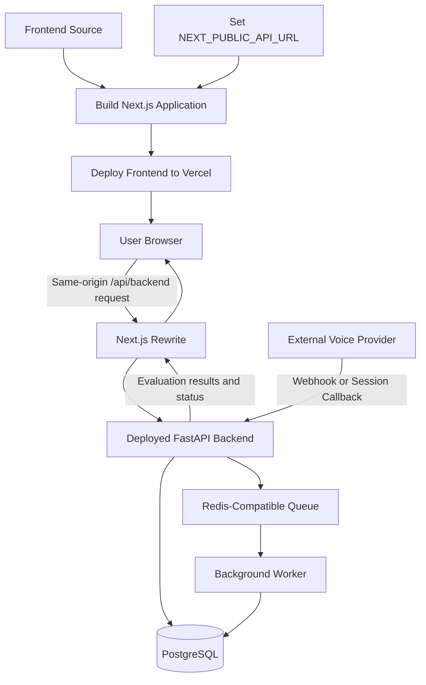

# Novora Voice AI Evaluation & Regression Monitoring

Novora is an evaluation and regression-monitoring platform for conversational AI voice agents. It helps teams test agent behavior against business scenarios, evaluate policy compliance, inspect transcript evidence, and compare baseline and candidate runs to identify regressions.

Rather than relying on whether an agent sounds fluent, Novora evaluates whether its behavior satisfies defined business requirements. The platform combines scenario-based testing, configurable criteria, transcript evidence, rule outcomes, and optional LLM-judge evaluation.

The frontend provides the operator dashboard. The FastAPI backend handles provider sessions, transcript ingestion, evaluation execution, verdict generation, persistence, and background processing.

**Backend API:** [novora-backend-616w.onrender.com](https://novora-backend-616w.onrender.com)

---

## Contents

- [What Novora does](#what-novora-does)
- [Core capabilities](#core-capabilities)
- [Product workflow](#product-workflow)
- [System architecture](#system-architecture)
- [Evaluation lifecycle](#evaluation-lifecycle)
- [Regression analysis](#regression-analysis)
- [Design system](#design-system)
- [Dashboard pages](#dashboard-pages)
- [Technology stack](#technology-stack)
- [Repository structure](#repository-structure)
- [Getting started](#getting-started)
- [Configuration](#configuration)
- [Testing and verification](#testing-and-verification)
- [Authentication and security](#authentication-and-security)
- [Build and deployment](#build-and-deployment)
- [Current limitations and roadmap](#current-limitations-and-roadmap)
- [Engineering trade-offs](#engineering-trade-offs)
- [Related resources](#related-resources)

---

## What Novora does

Voice agents can sound convincing while still making unauthorized promises, skipping required steps, inventing completed actions, or violating a business policy.

Novora provides an evaluation workflow for testing these behaviors against explicit business expectations.

Teams configure agents and providers, define scenarios and evaluation criteria, execute individual or batch tests, and inspect the evidence behind each result. They can then compare a baseline evaluation with a candidate run to investigate whether a change improved or degraded agent behavior.

The central workflow is:

**Configure → Define → Evaluate → Inspect → Compare → Improve**

Novora evaluates agents hosted by supported external providers. Its current dashboard does not require teams to use a Novora-managed voice runtime.

---

## Core capabilities

### Agent and provider management

Configure supported voice-agent providers and agents. Manage the settings required to run evaluations against those agents.

### Scenario-based evaluation

Define business scenarios, test inputs, and criteria that describe expected behavior. Scenario templates and configurable rules help express workflow requirements, policy limits, required information, and prohibited actions where supported.

### Evidence-backed verdicts

Inspect transcripts, message-level evidence, rule outcomes, and integrity details associated with an evaluation. Optional LLM-judge criteria can supplement deterministic checks.

Missing or ambiguous evidence should not be treated as proof of success. The backend's evaluation result can surface inconclusive or other non-passing outcomes where applicable.

### Evaluation history

Run individual evaluations or batches, follow asynchronous job status, and inspect saved results after completion.

### Regression monitoring

Compare baseline and candidate evaluations to investigate changes in agent behavior, including regressions and improvements across scenarios and rule outcomes.

### Integration and platform monitoring

Configure supported integrations, manage developer-owned HTTP tool endpoints where supported, inspect provider-shaped request results, and view platform health.

### Operator dashboard

Use a responsive dashboard with light and dark themes to organize agent configuration, test execution, review, and comparison workflows.

---

## Product workflow

Novora organizes the testing process around the complete evaluation lifecycle.



The dashboard supports this workflow through dedicated views for agents, integrations, scenarios, evaluations, and platform settings.

The objective is not merely to collect conversations. It is to make agent behavior testable, inspectable, and comparable against defined business expectations.

---

## System architecture

The frontend is built with Next.js and communicates with the FastAPI backend through a same-origin API proxy.

Normal dashboard API requests use the `/api/backend` path. Next.js rewrites those requests to the backend configured by `NEXT_PUBLIC_API_URL`. This keeps normal browser API calls on the frontend's origin.

Provider webhook addresses displayed in the dashboard point directly to the backend, because external providers need to reach the server independently of the user's browser.



### Component responsibilities

| Component | Responsibility |
|---|---|
| Next.js dashboard | Operator interface, navigation, forms, evaluation views, transcript inspection, and comparisons |
| Same-origin API proxy | Routes dashboard API requests to the configured backend |
| FastAPI backend | Provider integration, request processing, evaluation orchestration, verdict generation, and persistence |
| Provider session execution | Runs supported sessions with externally hosted voice agents |
| Transcript ingestion | Supplies conversation evidence to the evaluation system |
| Evaluation engine | Applies supported criteria and generates evaluation outcomes |
| PostgreSQL | Stores persistent application and evaluation data |
| Redis and worker | Support queued, asynchronous processing where configured |
| External providers | Host voice agents and provide the provider-specific session behavior Novora evaluates |

The dashboard and evaluation backend are separate execution layers. A page rendering successfully does not establish that a provider session, evaluation job, or database operation has succeeded.

---

## Evaluation lifecycle

Novora evaluates conversations against defined criteria instead of treating a fluent response as sufficient evidence of success.

The frontend allows users to configure scenarios and inspect the resulting evaluation. Session execution, transcript ingestion, rule evaluation, and verdict generation belong to the backend.



### Evaluation evidence

The dashboard can present:

- Conversation transcripts.
- Message-level evidence supporting evaluation results.
- Individual criterion and rule outcomes.
- Integrity details associated with the evaluation.
- Saved evaluation history.
- Baseline and candidate comparisons.

The exact evidence available depends on the evaluation result returned by the backend and the criteria used for a particular run.

### Deterministic checks and LLM-judge criteria

Deterministic checks evaluate explicit rules where the required evidence and rule type support it. Optional LLM-judge criteria can assess requirements that need model-based interpretation.

These approaches serve different purposes:

| Evaluation approach | Purpose | Important limitation |
|---|---|---|
| Deterministic rules | Check explicit requirements against available evidence | Results depend on rule design and evidence quality |
| LLM-judge criteria | Evaluate supported requirements requiring model-based interpretation | Judgments can be uncertain and should not be treated as infallible |
| Evidence review | Let operators inspect the transcript and supporting information | Review quality depends on transcript completeness and available context |

Novora surfaces evidence and outcomes so teams can investigate results instead of relying exclusively on a summary score.

---

## Regression analysis

An individual evaluation tells a team how an agent behaved in one test. Comparing evaluations makes changes in behavior easier to detect and investigate.

Novora's dashboard supports baseline/candidate comparisons so teams can inspect how runs differ and identify potential regressions or improvements.



A meaningful comparison depends on the compatibility of the selected evaluations, their available evidence, and the criteria being compared. A difference in outcome is a signal for investigation, not automatically proof of its cause.

---

## Design system

Novora uses a navy-and-blue visual identity with light and dark themes. The dashboard is designed to provide a consistent operator experience across configuration forms, status indicators, tables, evaluation evidence, and comparison views.

### Brand tokens

| Token | Light theme | Dark theme |
|---|---|---|
| Background | `#F8FAFC` | `#0A0F1E` |
| Surface | `#FFFFFF` | `#0B1F44` |
| Elevated surface | `#F1F5F9` | `#102956` |
| Primary text | `#0B1F44` | `#E2E8F0` |
| Secondary text | `#64748B` | `#94A3B8` |
| Border | `#E2E8F0` | `#1E293B` |
| Primary action | `#2563EB` | `#2563EB` |
| Light-theme primary hover | `#1D4ED8` | — |
| Dark-theme primary hover | — | `#3B82F6` |
| Success status | `#15803D` on `#DCFCE7` | `#22C55E` on `rgba(34,197,94,0.15)` |
| Warning status | `#B45309` on `#FEF3C7` | `#F59E0B` on `rgba(245,158,11,0.15)` |
| Error status | `#DC2626` on `#FEE2E2` | `#EF4444` on `rgba(239,68,68,0.15)` |

### Logo assets

- **Light theme:** `public/novora-logo-light.png` — hexagonal N icon with dark navy brand typography.
- **Dark theme:** `public/novora-logo-dark.png` — hexagonal N icon with white brand typography on a midnight background.

The frontend supports switching between light and dark themes.

---

## Dashboard pages

The main dashboard areas are organized around the evaluation lifecycle.

| Area | Responsibility |
|---|---|
| Overview | Summarizes platform activity and provides access to the main evaluation workflows |
| Agents | Configure and manage supported voice agents |
| Integrations | Configure supported provider and integration connections |
| Scenarios | Define business scenarios, evaluation criteria, and test inputs |
| Evaluations | Start evaluations, inspect run history, and follow asynchronous job status |
| Evaluation details | Review transcripts, rule outcomes, evidence, and integrity details |
| Regression comparisons | Compare baseline and candidate evaluations to investigate behavioral changes |
| Platform settings | Configure supported settings and inspect available platform health information |
| Knowledge Base | Reserved for planned Phase Two functionality; not currently an operational document-ingestion workflow |

The exact data and actions available on each page depend on the backend APIs and features implemented for that area.

---

## Technology stack

| Technology / component | Responsibility |
|---|---|
| Next.js 16 | Frontend application framework and routing |
| React | Interactive UI and reusable components |
| Node.js | Development and production runtime |
| npm | Dependency management and project scripts |
| FastAPI | Backend API and evaluation orchestration |
| PostgreSQL | Persistent application and evaluation data |
| Redis-compatible queue | Asynchronous processing where configured |
| Next.js rewrites | Same-origin proxying of dashboard API requests |
| Docker | Containerized deployment |
| Vercel | Frontend hosting and deployment target |

The frontend is a separate service from the FastAPI evaluation backend.

---

## Repository structure

The frontend is maintained separately from the backend. The primary application includes the dashboard, shared components, API proxy configuration, and automated tests.

```text
frontend/
├── public/
│   ├── novora-logo-light.png
│   └── novora-logo-dark.png
├── src/
│   ├── app/
│   ├── components/
│   ├── api/
│   ├── features/
│   ├── services/
│   ├── utils/
│   └── config/
├── tests/
│   └── e2e.test.mjs
├── next.config.mjs
├── package.json
├── package-lock.json
└── README.md
```

This is a conceptual overview, not a guarantee that every directory exists under precisely this name in every checkout. Consult the actual repository for the complete current file structure.

### Important implementation areas

- **App Router:** Dashboard pages and route handling.
- **Dashboard components:** Overview, agent/provider setup, scenarios, evaluation details, and comparisons.
- **API proxy configuration:** Routes same-origin `/api/backend` requests to the backend configured by `NEXT_PUBLIC_API_URL`.
- **Tests:** Contract tests and backend-dependent integration tests.
- **Public assets:** Logos and other static frontend resources.

---

## Getting started

### Requirements

- Node.js 20.9 or newer.
- npm.
- Access to the Novora FastAPI backend for authenticated and data-backed features.
- PostgreSQL and Redis-compatible infrastructure configured by the backend deployment.

### 1. Clone and install

From the frontend repository root:

```bash
npm ci
```

This installs the dependency versions recorded in `package-lock.json`.

### 2. Configure the backend URL

Create a local `.env.local` file in the frontend root:

```dotenv
NEXT_PUBLIC_API_URL=http://127.0.0.1:8000
```

Use this value when running the backend locally at that address.

To use the deployed backend instead:

```dotenv
NEXT_PUBLIC_API_URL=https://novora-backend-616w.onrender.com
```

`NEXT_PUBLIC_API_URL` is public configuration, not a place for secrets.

### 3. Start the frontend

```bash
npm run dev
```

Open:

`http://localhost:3000`

### 4. Start or connect to the backend

For local development, start the FastAPI backend separately using its documented setup instructions.

For remote development, configure the frontend to use the deployed API and ensure that the API and required external services are reachable.

**Backend API:** [https://novora-backend-616w.onrender.com](https://novora-backend-616w.onrender.com)

**Backend guide:** [`backend/README.md`](../backend/README.md)

### Local development workflow



---

## Configuration

### `NEXT_PUBLIC_API_URL`

Sets the backend origin used by the Next.js rewrite configuration.

Local example:

```dotenv
NEXT_PUBLIC_API_URL=http://127.0.0.1:8000
```

Deployed example:

```dotenv
NEXT_PUBLIC_API_URL=https://novora-backend-616w.onrender.com
```

Normal dashboard API calls use the same-origin `/api/backend` path, which Next.js rewrites to the configured backend.

Provider webhook URLs are different: external services must be able to reach the backend directly. They should not point to the dashboard's browser-only routes.

### Configuration principles

- Set the correct backend origin for the environment.
- Use a reachable URL for the backend and its webhook endpoints.
- Keep private credentials on the backend.
- Rebuild and redeploy when the production API rewrite destination changes if it is captured in the build configuration.
- Verify the actual rewrite and runtime configuration in `next.config.mjs` before deployment.

---

## Testing and verification

The frontend provides a contract test suite and a separate backend-dependent integration test.

### Run the contract tests

```bash
npm test
```

The contract suite can validate the frontend's expected API contracts and related behavior covered by those tests.

### Build the frontend

```bash
npm run build
```

### Run the integration suite

Start a compatible backend, then run:

```bash
node --test tests/e2e.test.mjs
```

By default, the integration suite uses the backend at:

`http://127.0.0.1:8000`

Set `NOVORA_API_BASE_URL` when the backend is listening at a different address.

For example:

```bash
NOVORA_API_BASE_URL=https://novora-backend-616w.onrender.com node --test tests/e2e.test.mjs
```

In PowerShell:

```powershell
$env:NOVORA_API_BASE_URL = "https://novora-backend-616w.onrender.com"
node --test tests/e2e.test.mjs
```

A successful build validates the frontend build process. The contract and integration suites validate only the behaviors they actually exercise. Neither a successful build nor a reachable dashboard proves that all provider sessions and evaluation workflows work in production.

### Suggested release verification

- [ ] Dependencies install successfully using `npm ci`.
- [ ] Contract tests pass.
- [ ] The frontend production build succeeds.
- [ ] The configured backend URL resolves correctly.
- [ ] Sign-up, sign-in, and current-account checks work.
- [ ] Authenticated requests reach the correct backend.
- [ ] Agents and scenarios can be configured using implemented workflows.
- [ ] Individual and batch evaluations can be started where supported.
- [ ] Evaluation status updates and saved results can be inspected.
- [ ] Transcript evidence and rule outcomes appear correctly.
- [ ] Baseline and candidate comparisons load for compatible evaluations.
- [ ] Provider callbacks and webhooks reach the backend when required.
- [ ] Missing, invalid, and expired authentication is handled without generating fake user or evaluation data.

---

## Authentication and security

### Authentication model

The backend returns a short-lived bearer token after signup or login. The frontend stores this token in browser local storage and attaches it to API requests.

This model works with the same-origin proxy and avoids the need for a cross-origin cookie configuration, but JavaScript running within the page can read the token.

### Security implications

- Keep dependencies and scripts trusted and regularly maintained.
- Never place signing secrets, provider keys, database credentials, or private integration tokens in frontend code.
- Ensure that protected backend endpoints validate authentication and authorization.
- Treat local storage as an exposed browser storage surface rather than a secure secret vault.
- Consider secure, HttpOnly cookies as a potential future improvement, which would require coordinated frontend and backend changes.
- Ensure that provider webhook endpoints have appropriate authentication or verification mechanisms according to the provider and endpoint design.

### No fake authenticated fallback

The dashboard does not fill a disconnected session with a fake user or demo evaluation records. When authentication cannot be verified, it reports the issue and directs the user to sign in.

This avoids presenting simulated account or evaluation state as if it were real customer data.

### Same-origin proxy boundary

The `/api/backend` rewrite routes browser requests to the backend. It is a routing mechanism, not an authorization layer.

The backend must still authenticate users, validate resource ownership, and enforce permissions for every protected request.

---

## Current limitations and roadmap

The following distinctions describe current capabilities versus explicitly planned work.

### Current product boundary

Novora currently evaluates agents hosted by supported external providers. Provider session execution, transcript ingestion, evaluation, and verdict generation happen in the backend.

The frontend is an operator dashboard for this existing evaluation system, not a fully managed voice runtime.

### Knowledge Base — Phase Two

The Knowledge Base page is planned Phase Two work.

It does not currently upload, index, or retrieve customer documents, and it does not affect evaluation verdicts.

The expected future scope includes:

- Authorized, read-only knowledge sources.
- Retrieval-grounded checks against approved policies and facts.
- Source and version references in evaluation reports.

These capabilities should not be considered implemented until their end-to-end workflows are available.

### Managed Voxia runtime

A future dashboard path may support configuring and operating Novora's managed voice runtime, including live streaming and interruption handling.

Today, Novora evaluates agents hosted by external providers. The managed runtime is a roadmap concept rather than a current end-to-end dashboard workflow.

### LangGraph workflows

Stateful and branching orchestration for richer multi-turn or multi-agent evaluation workflows is planned work.

It should not be described as a complete current feature solely because LangGraph is part of a proposed future design.

### Organizations and RBAC

Organization scopes, role-based permissions, and related access governance are planned capabilities.

The future implementation will require coordinated frontend and backend authorization rather than relying on frontend visibility controls.

No release date is committed for these roadmap items.

---

## Build and deployment

The frontend can be deployed separately from the FastAPI backend. The dashboard's API proxy needs a reachable backend URL, while provider webhooks must be configured to reach the backend directly.

The project documentation describes a Vercel Docker deployment path for the frontend, with PostgreSQL and Redis-compatible infrastructure supplied to the backend.

### Deployment flow



### Deployment checklist

1. Configure the deployed backend origin using `NEXT_PUBLIC_API_URL`.
2. Confirm that the frontend rewrite destination matches the intended API.
3. Deploy the backend with its required secrets and service configuration.
4. Configure PostgreSQL with durable persistence.
5. Configure Redis-compatible infrastructure and the worker where asynchronous jobs are enabled.
6. Make provider callback and webhook endpoints reachable through the backend.
7. Confirm authentication and protected API access.
8. Verify evaluation execution and saved results against the deployed API.
9. Check backend and frontend logs for failures.
10. Rebuild the frontend when the public API destination needs to change.

### Secret management

Never place credentials in `NEXT_PUBLIC_*` variables. These values are exposed to browser code.

Private model-provider tokens, signing secrets, database credentials, and integration tokens belong in backend environment variables or the hosting provider's secret-management settings.

The backend must be deployed and operational independently of the dashboard.

---

## Engineering trade-offs

| Decision | Benefit | Trade-off / limitation |
|---|---|---|
| Same-origin API proxy | Keeps ordinary dashboard requests on the frontend origin and avoids direct browser cross-origin API calls for that path | The proxy target must be configured correctly, and the backend still needs appropriate authentication and authorization |
| External-provider evaluation | Supports evaluating voice agents hosted by supported external providers | Execution and callback behavior depend on provider compatibility, network availability, credentials, and integration configuration |
| Evidence-backed evaluation | Makes verdicts more inspectable by exposing transcripts and criterion-level evidence | Evidence quality depends on transcript completeness, rule design, and evaluation configuration |
| Deterministic checks plus optional LLM judge | Supports explicit policy checks alongside supported interpretation-based criteria | Deterministic rules depend on suitable evidence, while LLM judgments can be uncertain |
| Baseline/candidate comparisons | Helps identify changes in outcomes and investigate regressions | Comparisons are meaningful only when the runs and criteria are sufficiently compatible |
| Browser local-storage token | Provides a straightforward bearer-token flow through the proxy | Page JavaScript can read the token; secure HttpOnly cookies remain a possible future alternative |
| Separate frontend and backend deployment | Allows independent releases and scaling | API configuration, provider callbacks, authentication, and service compatibility must remain aligned |
| Roadmap separation | Prevents planned runtime, knowledge, and organization capabilities from being confused with existing functionality | Planned features should not be advertised as operational until implemented and verified |

---

## Related resources

- **Backend API:** [https://novora-backend-616w.onrender.com](https://novora-backend-616w.onrender.com)
- **Backend documentation:** [`backend/README.md`](../backend/README.md)

---

## Summary

Novora provides an operator dashboard for testing conversational voice agents against business scenarios, inspecting evidence-backed evaluation outcomes, and comparing runs to investigate behavioral regressions.

Its frontend handles configuration, visualization, and review. The FastAPI backend handles provider interactions, transcript ingestion, evaluation execution, verdict generation, persistence, and asynchronous processing where configured.

The product's central principle is simple:

**A voice agent should be evaluated on whether it does the right thing, not merely on whether it sounds convincing.**
