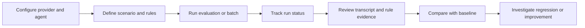
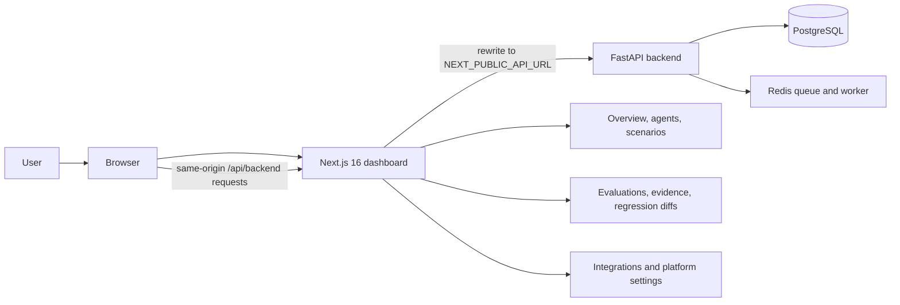

# Novora dashboard

The frontend is Novora's operator dashboard for evaluating conversational voice agents. Teams configure agents and business scenarios, run tests through supported providers, inspect transcript evidence for each verdict, and compare runs to find regressions. The dashboard presents results from the provider-neutral evaluation system; provider session execution, transcript ingestion, and verdict generation happen in the FastAPI backend.

## Product workflow



The dashboard is organized around the evaluation lifecycle: the overview summarizes platform activity; Agents and Integrations hold provider setup; Scenarios define business goals and checks; Evaluations show run history, transcripts, evidence, and rule outcomes. Baseline/candidate comparisons make changes in agent behavior easier to investigate. The dashboard does not treat a fluent response as proof of success: missing or ambiguous evidence is shown as inconclusive or otherwise surfaced in the backend result.

## Dashboard architecture



The browser sends API requests to the dashboard's same origin. Next.js rewrites the /api/backend path to the backend configured by NEXT_PUBLIC_API_URL; this keeps normal dashboard API calls away from browser cross-origin requests. Webhook addresses displayed for provider setup point directly to the backend.

## Current capabilities

- Sign up, sign in, and check the current account.
- Configure supported voice-agent providers and agents.
- Define scenarios, criteria, and test inputs.
- Run evaluations and inspect status, transcript evidence, rule outcomes, and integrity details.
- Review message-level evidence behind deterministic results and optional LLM-judge criteria; ambiguous or missing evidence is surfaced instead of presented as a pass.
- View run history and compare baseline and candidate evaluations.
- Configure supported integrations and inspect platform health.
- Configure developer-owned HTTP tool endpoints and inspect their actual provider-shaped request results where supported.
- Run individual or batch evaluations, follow asynchronous job status, and inspect saved outcomes after completion.
- Use scenario templates and configurable criteria to express workflow, policy, and tool-use expectations.
- Light and dark themes.

The dashboard no longer fills a disconnected session with a fake user or demo evaluation records. When authentication cannot be verified, it reports the issue and directs the user to sign in.

## Authentication tradeoff

The backend returns a short-lived bearer token after signup or login. The frontend stores it in browser local storage and attaches it to API requests. This works with the same-origin proxy and avoids cookie cross-origin setup, but JavaScript running in the page can read the token. Keep dependencies and scripts trusted; a future move to secure, HttpOnly cookies would reduce token exposure to browser scripts but requires coordinated backend and frontend changes.

## Knowledge Base page

## Planned frontend roadmap

These are roadmap concepts shown in the dashboard, not current end-to-end workflows. No release date is committed.

- **Knowledge sources:** The Knowledge page is a roadmap screen. It does not upload, index, or retrieve customer documents and does not affect evaluation verdicts. Planned work includes authorized read-only sources, retrieval-grounded checks against approved policies and facts, and source/version references in reports.
- **Managed Voxia runtime:** A future dashboard path for configuring and operating Novora's managed voice runtime, including live streaming and interruption handling. Today, Novora evaluates agents hosted by external providers.
- **LangGraph workflows:** Planned stateful and branching orchestration for richer multi-turn or multi-agent evaluation flows.
- **Organizations and RBAC:** Planned organization scopes, role-based permissions, and associated access governance.

## Local setup

Requirements: Node.js 20.9 or newer and npm.

```sh
npm ci
npm run dev
```

Open http://localhost:3000. Run the API separately as described in [backend/README.md](../backend/README.md), then set NEXT_PUBLIC_API_URL to the API origin before starting Next.js.

### Checks

```sh
npm test
npm run build
```

The contract suite runs with npm test. The integration suite uses a running backend:

```sh
node --test tests/e2e.test.mjs
```

Set NOVORA_API_BASE_URL if the backend is not listening at http://127.0.0.1:8000.

## Render Docker deployment

Create a Render Web Service from this repository with the Docker runtime and root Dockerfile. Set NEXT_PUBLIC_API_URL to the deployed backend's public HTTPS origin before the Docker build. The container listens on 0.0.0.0 at Render's PORT, default 10000.

Deploy the API separately with PostgreSQL and Redis-compatible Key Value. The dashboard's API proxy needs a reachable backend URL; provider webhooks need the backend URL directly. Do not put secrets in NEXT_PUBLIC_* variables because Next.js exposes those values to the browser.
