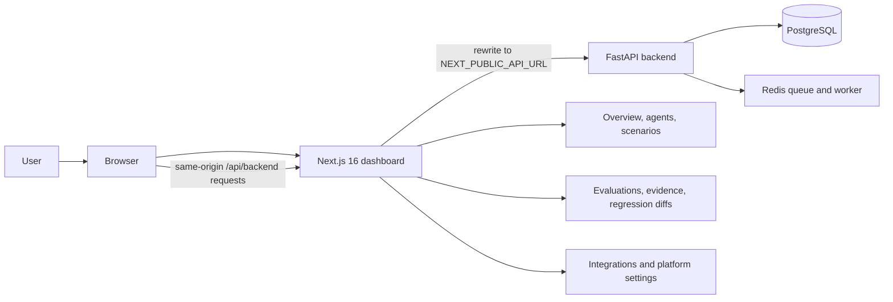

# Novora dashboard

The frontend is the Next.js dashboard for creating and running voice-agent evaluations, reviewing evidence, and comparing results. It is a separate repository and deployable service from the FastAPI backend.

Novora helps teams check whether voice agents follow configured business workflows and policies, then inspect transcript evidence for each result. The dashboard is the operator-facing part of a provider-neutral evaluation system; provider session execution, ingestion, and verdict generation happen in the backend. See the [recruiter-facing project overview](../PROJECT_OVERVIEW.md) for the complete product description, architecture flowcharts, and planned Phase Two work.

## Dashboard architecture


# Novora Frontend Dashboard

**Novora** is an enterprise evaluation, regression monitoring, and policy compliance infrastructure dashboard for conversational AI voice agents.

This frontend application is built to provide a desktop-first, highly responsive, and accessible interface with working light and dark modes that connects end-to-end to the FastAPI backend.

---

## 🎨 Design Identity & Brand Tokens

The dashboard implements Novora's official design system:

| Token Name | Light Scheme | Dark Scheme (Midnight) |
| :--- | :--- | :--- |
| **Background** | `#F8FAFC` | `#0A0F1E` |
| **Surface** | `#FFFFFF` | `#0B1F44` |
| **Elevated Surface** | `#F1F5F9` | `#102956` |
| **Primary Text** | `#0B1F44` | `#E2E8F0` |
| **Secondary Text** | `#64748B` | `#94A3B8` |
| **Border** | `#E2E8F0` | `#1E293B` |
| **Primary Action** | `#2563EB` (hover: `#1D4ED8`) | `#2563EB` (hover: `#3B82F6`) |
| **Success Status** | `#15803D` (`#DCFCE7` bg) | `#22C55E` (`rgba(34,197,94,0.15)` bg) |
| **Warning Status** | `#B45309` (`#FEF3C7` bg) | `#F59E0B` (`rgba(245,158,11,0.15)` bg) |
| **Error Status** | `#DC2626` (`#FEE2E2` bg) | `#EF4444` (`rgba(239,68,68,0.15)` bg) |

### 🖼️ Dynamic Brand Logo
- **Light Theme**: `public/novora-logo-light.png` (Hexagonal N icon with dark navy brand typography).
- **Dark Theme**: `public/novora-logo-dark.png` (Hexagonal N icon with white brand typography on midnight background).

---

## 🚀 Key Modules & Capabilities

The browser sends API requests to the dashboard's same origin. Next.js rewrites the /api/backend path to the backend configured by NEXT_PUBLIC_API_URL; this keeps normal dashboard API calls away from browser cross-origin requests. Webhook addresses displayed for provider setup point directly to the backend.

## Current capabilities

- Sign up, sign in, and check the current account.
- Configure supported voice-agent providers and agents.
- Define scenarios, criteria, and test inputs.
- Run evaluations and inspect status, transcript evidence, rule outcomes, and integrity details.
- Review message-level evidence behind deterministic results and optional LLM-judge criteria; ambiguous or missing evidence is surfaced instead of presented as a pass.
- View run history and compare baseline and candidate evaluations.
- Configure supported integrations and inspect platform health.
- Configure developer-owned HTTP tool endpoints and inspect their actual provider-shaped request results where supported.
- Light and dark themes.

The dashboard no longer fills a disconnected session with a fake user or demo evaluation records. When authentication cannot be verified, it reports the issue and directs the user to sign in.

## Authentication tradeoff

The backend returns a short-lived bearer token after signup or login. The frontend stores it in browser local storage and attaches it to API requests. This works with the same-origin proxy and avoids cookie cross-origin setup, but JavaScript running in the page can read the token. Keep dependencies and scripts trusted; a future move to secure, HttpOnly cookies would reduce token exposure to browser scripts but requires coordinated backend and frontend changes.

## Knowledge Base page

The Knowledge Base page is a Phase Two roadmap screen. It does not currently upload, index, or retrieve customer documents, and it does not affect evaluation verdicts. See the [project overview](../PROJECT_OVERVIEW.md) for the Phase Two scope, including authorized read-only knowledge sources, retrieval-grounded checks, and source/version traceability. The frontend roadmap also lists the managed Voxia runtime, LangGraph orchestration, and organization access controls/RBAC. These are planned capabilities, not current dashboard workflows; no release date is committed.

## Local setup

Requirements: Node.js 20.9 or newer and npm.

```sh
npm ci
npm run dev
```

Open http://localhost:3000. Run the API separately as described in [backend/README.md](../backend/README.md), then set NEXT_PUBLIC_API_URL to the API origin before starting Next.js.

### Checks

```sh
npm test
npm run build
```

The contract suite runs with npm test. The integration suite uses a running backend:

```sh
node --test tests/e2e.test.mjs
```

Set NOVORA_API_BASE_URL if the backend is not listening at http://127.0.0.1:8000.

## Vercel Docker deployment

Deploy the API separately with PostgreSQL and Redis-compatible Key Value. The dashboard's API proxy needs a reachable backend URL; provider webhooks need the backend URL directly. Do not put secrets in NEXT_PUBLIC_* variables because Next.js exposes those values to the browser.
